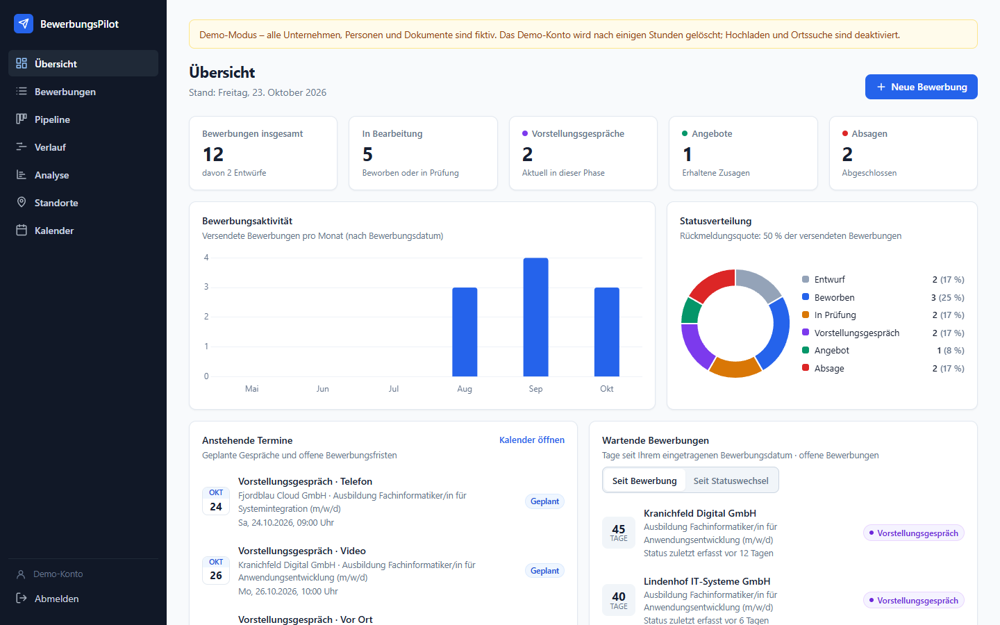

# BewerbungsPilot

A web application for organising your own job applications: applications, statuses, documents,
interviews, deadlines and a history of every change, in one place. The user interface is in German.

I built it as a portfolio project for my application for an apprenticeship as a
*Fachinformatiker für Anwendungsentwicklung*. The [demo mode](#quick-start-demo-with-fictional-data)
runs on your own computer with one command. A public demo on Fly.io is prepared
([docs/deployment.md](docs/deployment.md)) but not online yet.



## Features

| Area | What it does |
|---|---|
| **Applications** (`Bewerbungen`) | Create, edit and delete. Search, filter and sort. Warning for possible duplicates (same company and similar position). Detail panel with tabs. |
| **Dashboard** (`Übersicht`) | Key figures, chart of applications per month, status distribution, upcoming dates, waiting applications. All values are computed from the data. |
| **Pipeline** | Kanban board with drag and drop (SortableJS). The status can also be changed by keyboard. Every status change is written to the history. |
| **Documents** | PDF upload (max. 10 MB, file signature checked), preview in the browser, download. Files are stored outside the web root under random names, with a SHA-256 fingerprint. |
| **Calendar** (`Kalender`) | Interviews (phone, video, on site) and application deadlines in a month view and an agenda. |
| **History** (`Verlauf`) | Timeline of each application's recorded statuses, plus a queue of applications that are waiting for an answer. |
| **Analysis** (`Analyse`) | How many applications reached which stage (review, interview, offer) by a chosen cutoff date. |
| **Locations** (`Standorte`) | Map (Leaflet + OpenStreetMap) of confirmed employer locations, straight-line distance from a starting point, route links. |
| **Accounts** | Login with ASP.NET Core Identity. Every user sees only their own data. |
| **Demo mode** | Start page for visitors and a separate throwaway account with fictional data for each of them (see below). |

More screenshots: [Pipeline](docs/screenshots/03-pipeline.png) ·
[Applications + detail panel](docs/screenshots/08-detail.png) · [Calendar](docs/screenshots/04-kalender.png) ·
[History](docs/screenshots/05-verlauf.png) · [Analysis](docs/screenshots/06-analyse.png) ·
[Locations](docs/screenshots/07-standorte.png) · [Login with demo button](docs/screenshots/00-anmeldung.png)

## Quick start: demo with fictional data

Requirements: [.NET SDK 10](https://dotnet.microsoft.com/download) and Git.

```bash
git clone https://github.com/jerwelz/BewerbungsPilot.git
cd BewerbungsPilot
dotnet run --project src/BewerbungsPilot --launch-profile demo
```

Open <http://localhost:5216>: the start page explains the app. Click **Demo starten** to get your own demo account with
12 fictional applications. The data lives in `src/BewerbungsPilot/storage-demo/`, and the account is
deleted after 4 hours. Uploads and the place search are switched off in the demo.

## Private use

```bash
dotnet run --project src/BewerbungsPilot
```

Open <http://localhost:5216> and register (registration is open only in the `Development` environment).
The data is stored in `src/BewerbungsPilot/storage/`, which is excluded from Git. For operator commands
(safe migration with backup, password reset), see [docs/security.md](docs/security.md#6-operator-commands).

## Technology

| Layer | Used |
|---|---|
| Backend | C# 14, ASP.NET Core 10 (Minimal APIs), ASP.NET Core Identity |
| Data | Entity Framework Core 10, SQLite |
| Frontend | HTML, CSS, JavaScript (ES modules, no framework, no build step); Chart.js, SortableJS, Leaflet (vendored in `wwwroot/lib`) |
| Tests | xUnit (real in-memory SQLite + `WebApplicationFactory`), Playwright browser tests |
| CI | GitHub Actions (`.github/workflows/ci.yml`) |

### Why this stack

- **ASP.NET Core with Minimal APIs.** C# is widely used in German companies and in the apprenticeship. Minimal APIs keep each HTTP endpoint short and readable: one method maps a URL to a call in the logic layer, without controller base classes.
- **Entity Framework Core.** Tables are plain C# classes, and schema changes are versioned migrations. Global query filters are what make per-user isolation work (see below).
- **SQLite.** The app is meant for one person or a few accounts, so a single database file is enough. There is no database server to install or run, and backups are a file copy (`VACUUM INTO`). The trade-off is that SQLite does not suit many parallel writers or several server instances. This is listed under limitations.
- **No frontend framework.** The pages are server-rendered HTML files that load their data with `fetch`. This avoids a JavaScript build chain and keeps the code small enough to explain completely.

## Architecture

```
Browser (wwwroot: HTML pages + ES modules)
   │  fetch() JSON, login cookie, X-CSRF-TOKEN header
   ▼
Endpoints/   HTTP only: routes, input → service call → status code   (e.g. ApplicationEndpoints.cs)
   ▼
Logic/       business rules, plain testable classes                  (e.g. ApplicationService.cs)
   ▼
Data/        EF Core DbContext, entities, migrations                 (AppDbContext.cs, Entities.cs)
   ▼
SQLite file + documents folder in storage/ (outside wwwroot)
```

- `Program.cs` wires everything together: database, Identity, cookies, antiforgery, rate limiting, security headers, endpoint groups.
- Business rules (status changes with a history entry, date checks, duplicate detection, waiting times, analysis) live in `Logic/` and do not depend on HTTP. This is why most tests run directly against the services.
- History entries are written by the services in the same `SaveChanges` call as the change itself, so a status and its history entry are always saved together.

### Data and persistence

- One SQLite file: `storage/bewerbungspilot.db` (WAL mode). Tables: `Applications`, `ApplicationEvents` (history), `Documents`, `Interviews`, plus the Identity tables `AspNet*`.
- Documents: `storage/documents/<random GUID>.pdf`. The original file name is kept only in the database.
- A **new** database is created automatically. An **existing** database is migrated only by the explicit `migrate` command. Before migrating, it makes a verified backup and checks the data afterwards ([details](docs/security.md#6-operator-commands)).
- `storage/` and every `storage-*/` folder are listed in `.gitignore`.

### Accounts and data isolation

- ASP.NET Core Identity: password hash (PBKDF2), lockout after 5 failed attempts, rate limit on login, HttpOnly + SameSite=Strict cookie, antiforgery token on every write request.
- Every endpoint requires a login unless it is explicitly marked as anonymous.
- **Isolation in the data layer, not in each endpoint.** EF Core global query filters return only the current user's rows. In addition, an ownership check in `SaveChanges` rejects any write that touches another user's data. Another user's id answers `404`, the same as an id that does not exist.
- Tests check every API endpoint against an authorization matrix, and fail if a new endpoint is added without being covered.

Full description, guarantees and limitations: [docs/security.md](docs/security.md).

### Public demo deployment (prepared)

`Dockerfile` + `fly.toml`: one container on Fly.io with one volume for the SQLite file, HTTPS by
Fly's proxy, demo mode only, deployed manually through the GitHub Actions workflow
`deploy.yml`. Security for the internet: HTTPS redirect and HSTS, `__Host-` Secure cookies,
Content-Security-Policy, forwarded headers only from the configured proxy, rate limits, 1 MB request
limit, German error messages without internals, `/health` for the platform. Details, costs and the
choice of provider: [docs/deployment.md](docs/deployment.md).

### Demo mode

Switched on with `Demo:Enabled=true` (the `demo` launch profile does this):

- Visitors who are not logged in see a **start page** (`willkommen.html`) with a short description,
  screenshots and the buttons „Demo starten“ and „Anmelden“. Without demo mode it forwards straight to the login page.
- **"Demo starten"** creates a new account without a password (nobody can log in to it with a password), fills it with fictional data and signs the visitor in. Visitors are isolated from each other by the same mechanism as real users.
- Demo accounts are deleted after `Demo:AccountLifetime` (default 4 h), together with their files (checked every 10 minutes). At most `Demo:MaxAccounts` (default 200) exist at the same time.
- Limits against abuse: 5 demo starts per IP and hour, 60 changes per visitor and minute, 50 applications and 100 interviews per demo account.
- Uploads, place search (Nominatim) and registration are switched off.
- **Safeguards against starting on real data.** The app refuses to start in demo mode if the data folder is the default `storage/` folder, or if the database contains any account that is not a demo account. A public instance (not `Development`) additionally needs a real host name and an absolute data folder.
- When demo mode is off, the demo endpoint does not exist.

## Tests

```bash
dotnet test                     # xUnit: 286 tests
```

Covered: services (status changes, date rules, duplicates, dashboard, schedule, timeline, analysis, map), document validation (size, file signature, file names), ownership and isolation, the HTTP authorization matrix, CSRF, login, lockout, sessions, migration safety on populated databases, demo mode, and the production configuration (HTTPS, headers, proxy, limits, restart persistence).

Browser tests (Playwright, Microsoft Edge, Node.js 24):

```bash
cd tests/e2e
npm ci
npx playwright install msedge   # only if Microsoft Edge is not installed
node run.mjs                    # all suites; or e.g. node run.mjs m4 m10
```

The CI workflow additionally builds the Docker image on Linux and runs `tests/container/smoke.mjs`
against it (production demo behind a simulated proxy, including a restart).

`run.mjs` builds the app once. It starts a separate instance on port 5299 for every suite, each with its own throwaway data folder (`tests/e2e/.data/`), and never uses `storage/`.

## Project structure

```
src/BewerbungsPilot/
  Program.cs            startup and configuration
  AdminCommands.cs      command line: migrate, claim-legacy-data, reset-password
  Endpoints/            HTTP endpoints (one file per area)
  Logic/                services and rules (incl. DemoAccounts, DemoSeeder)
  Data/                 DbContext, entities, migrations, MigrationSafety
  wwwroot/              pages, js/, css/, lib/ (third-party libraries)
tests/BewerbungsPilot.Tests/   xUnit tests
tests/e2e/                     Playwright browser tests, screenshot script
tests/container/               smoke test for the Docker image (CI)
docs/                          security, external services, deployment, portfolio notes, screenshots
Dockerfile, fly.toml           container image and Fly.io configuration for the public demo
```

## Known limitations

- Built for **local use** and a small number of accounts. The public demo deployment is prepared but not online yet ([docs/deployment.md](docs/deployment.md)).
- SQLite: one server instance only, not suited for high parallel write load.
- No e-mail functions: no password reset by e-mail, no e-mail verification, no reminders. Passwords are reset with an operator command.
- No two-factor authentication, no account deletion in the UI, no admin interface.
- Documents: PDF only, no versioning (a document can be deleted and uploaded again).
- The map uses OpenStreetMap tiles, and the place search uses Nominatim. Both are external services ([docs/external-services.md](docs/external-services.md)).
- The browser tests run with Microsoft Edge on Windows. On Linux, only the container smoke test runs (in CI).
- The interface is German only.

## Development status

Developed in 11 milestones (Git tags `m1`–`m11`). Main features, account system, demo mode and the preparation of the public demo are complete. Possible next steps: going live on Fly.io, e-mail-based password reset.

## About this project

This project was developed with an AI coding assistant (Claude Code). Requirements, milestone
scope and approval of each step came from me. The code was written with the assistant's help. The
commit history shows the order of the milestones.

## License

No license has been chosen yet. All rights reserved until a license file is added.
